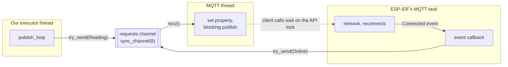

# MQTT integration design

Status: approved by the project owner on 2026-10-17, after three
independent reviews and two more on later additions. Implementation plan:
`docs/superpowers/plans/2026-10-17-mqtt-integration.md`.

Depends on the [workspace split](2026-10-17-workspace-split-design.md), which
is implemented first. Pure logic in this design goes in the `fak-core` crate,
where its tests run on the development machine.

Added after the three reviews, and reviewed once since (no blockers, fixes
applied): [section 6](#6-errors-and-logging), the `fak_core::link` block in
section 2, the `fak-core` notes in section 3, and the section 4 revisions
(`fak-core/src/moisture.rs`, the tests, and `fak_core::readout`).

This document describes how the `lector-humedad` firmware (ESP32-C3 Super Mini,
target `riscv32imc-esp-espidf`) connects to WiFi and publishes moisture
readings to the `fak` MQTT broker.

Sources this design follows:

- `fak-docs/docs/mqtt/conexion.md`: MQTT5 connection parameters.
- `fak-docs/docs/mqtt/organizacion-topicos.md`: topic layout and payloads.
- `fak-docs/docs/mqtt/acl.md`: broker ACL, where the username is the device ID.
- `fak-supporting`: Mosquitto broker (port 1883, authentication required) and
  TimescaleDB.
- `std-training/common/lib/wifi` (commit `f2223b5`) and
  `std-training/intro/http-client`: WiFi setup and configuration patterns.

Locked versions this design was checked against: `esp-idf-svc` commit
`d42a678`, `esp-idf-hal` commit `0d16dca`, ESP-IDF v5.5.3, `embassy-time`
0.5.1, `embassy-sync` 0.8.0, `embassy-futures` 0.1.2.

## 1. Scope

### Goal

Publish this board's moisture readings to the `fak` broker, following the
`fak/v1/devices/<device-id>/...` topic convention.

### In scope

- WiFi connectivity. The project has no networking today.
- Time synchronization over SNTP, so payloads carry a real timestamp.
- MQTT5 connection with authentication and a persistent session.
- `meta/availability` with an MQTT5 Last Will (online and offline states),
  republished as online after every reconnect.
- `readings/<reading-id>` for each gauge on the board, published about
  every 60 seconds, retained, with a 180-second `messageExpiry`.
- A restart path for setup failures and prolonged WiFi loss.
- A `Gauge` trait that decouples sensors from MQTT.
- A redesign of the moisture sensor (types, calibration, self-refresh).
- The TM1637 display as a read-only consumer of a gauge.

### Out of scope

See [section 8](#8-deferred). In short: `meta/identity`,
`meta/capabilities`, `meta/metrics`, `actionables/*`, `config/*`, full WiFi
reconnection handling, and status indication hardware.

## 2. WiFi module (`src/wifi.rs`, new)

Adapted from `std-training/common/lib/wifi`. It's a module in this crate, not
a path dependency on `std-training`.

### `wifi::connect`

```rust
pub fn connect(
    ssid: &str,
    password: &str,
    modem: Modem<'static>,
    sysloop: EspSystemEventLoop,
) -> anyhow::Result<EspWifi<'static>>;
```

`Modem` comes from `esp_idf_svc::hal::modem`. `EspWifi::new` takes any
`M: WifiModemPeripheral`, which the HAL implements for `Modem<'_>`. The
`impl Peripheral<P = Modem>` parameter in `std-training` comes from an older
HAL version that had a `Peripheral` trait; this version doesn't.

It keeps the three fixes from `std-training` commit `f2223b5`, because this
project uses the same board:

- **NVS for radio calibration.** Pass `EspDefaultNvsPartition::take()` to
  `EspWifi::new()`, so the radio calibration data persists across reboots.
  Without it, `phy_init` logs "NVS has not been initialized" on every boot.
- **8 dBm transmit power.** Call `esp_wifi_set_max_tx_power(30)` right after
  `wifi.start()`. The unit is 0.25 dBm, so 30 means 8 dBm. This works around
  the antenna design of ESP32-C3 Super Mini v1 boards. See
  <https://forum.arduino.cc/t/no-wifi-connect-with-esp32-c3-super-mini/1324046/24>.
- **Connection retries.** Up to 5 attempts, using `BlockingWifi` during setup.
  After each failure, call `disconnect()` and wait 500 ms. After the last
  failure, return the error.

`run()` calls it once, during setup, before anything else runs.

### `wifi::monitor`

```rust
pub async fn monitor(wifi: &mut EspWifi<'static>);
```

Every 5 seconds, checks `wifi.is_up()` (link and IP address). `is_connected()`
only checks the radio link, and a link without an IP address can't reach the
broker. `is_up()` returns `Result<bool>`; an `Err` counts as "down".

- When WiFi goes down, it calls `wifi.connect()` once. That's the
  non-blocking `EspWifi` method, not `BlockingWifi`'s, so it doesn't stall the
  executor. Neither ESP-IDF nor `esp-idf-svc` reconnects a station
  automatically, so without this call every drop would end in a restart.
- If WiFi is still down 60 seconds after the drop, it calls
  `restart::fail_and_restart`.

The monitor takes `&mut EspWifi` because it's the only code that uses WiFi
after setup. It's named "monitor", not "watchdog", so it isn't confused with
ESP-IDF's task watchdog timer (`esp_idf_svc::hal::task::watchdog`).

The decision lives in `fak-core`, so it's testable without WiFi or real time:

```rust
// fak_core::link
/// How long the link may stay down before the board restarts.
pub const DOWN_LIMIT: core::time::Duration = core::time::Duration::from_secs(60);

#[must_use]
#[derive(Debug, Clone, Copy, PartialEq, Eq)]
pub enum Action {
    Wait,
    Reconnect,
    Recovered,
    Restart,
}

#[derive(Debug, Default)]
pub struct LinkMonitor {
    down_since: Option<core::time::Duration>,
}

impl LinkMonitor {
    /// `now` is the time since boot.
    pub fn step(&mut self, is_up: bool, now: core::time::Duration) -> Action;
}
```

| `is_up` | `down_since` before | Result | `down_since` after |
|---|---|---|---|
| `true` | `None` | `Wait` | `None` |
| `true` | `Some(_)` | `Recovered` | `None` |
| `false` | `None` | `Reconnect` | `Some(now)` |
| `false` | `Some(t)`, `now - t` < `DOWN_LIMIT` | `Wait` | unchanged |
| `false` | `Some(t)`, `now - t` ≥ `DOWN_LIMIT` | `Restart` | unchanged |

- The elapsed time is `now.saturating_sub(t)`. Plain `-` on a `Duration`
  panics if the result would be negative. That can't happen with a clock that
  only moves forward, but `saturating_sub` returns zero instead, so a clock
  oddity can't reboot the board.
- `Action` derives `Debug` and `PartialEq` because the tests compare results
  with `assert_eq!`, which needs both.
- `#[must_use]` on `Action` makes the compiler warn about a call like
  `monitor.step(..);` whose result is ignored. Pedantic's
  `must_use_candidate` doesn't cover this, because it skips `&mut self`
  methods.
- `DOWN_LIMIT` is the one place the 60 seconds is written. The code and the
  tests both use it, so changing it can't leave a test checking the old
  value.

The async `monitor` only reads `is_up()` and the clock, calls `step`, and acts
on the result:

- `Reconnect`: logs a warning, then calls `wifi.connect()`. If that call
  itself returns `Err`, it logs the error as a warning and carries on. The
  next checks return `Wait` until the link is back or 60 seconds have passed.
- `Recovered`: logs at `info`.
- `Restart`: calls `fail_and_restart` with an error saying WiFi was down for
  60 seconds.

Tests cover each row of the table, including exactly 59.999 s (`Wait`) and
exactly 60 s (`Restart`), and a recovery followed by a new drop, which must
return `Reconnect` again. `now` is a `core::time::Duration`, because
`fak-core` doesn't depend on `embassy-time`. The firmware converts with
`core::time::Duration::from_millis(Instant::now().as_millis())`.

## 3. MQTT module (`src/mqtt.rs`, new)

`mqtt.rs` knows the `Gauge` trait and the `fak/v1` topic layout. It
doesn't know about moisture or any other sensor type.

The pure parts live in `fak-core`: the device ID and topic builders in
`fak_core::topics`, and JSON formatting in `fak_core::payload`. `mqtt.rs`
holds the parts that need ESP-IDF: the client, its thread, and its callback.

### Overview: a dedicated MQTT thread

All MQTT client calls happen on one dedicated `std::thread`, the **MQTT
thread**. The async side (our `block_on` executor) never calls the MQTT
client. It only sends publish requests to the MQTT thread through a channel.



Why a dedicated thread:

- ESP-IDF's MQTT task holds the client's API lock while it reconnects: DNS
  (which has no timeout, `esp-tls/esp_tls.c:221`), the TCP connection, and
  waiting for the broker's CONNACK, the last two each limited by
  `network_timeout` (`mqtt_client.c`, `esp_mqtt_task`). Every client call, including
  `esp_mqtt5_client_set_publish_property`, waits for that lock. If our executor
  made those calls, a reconnect attempt would freeze the sensor, the display,
  and the WiFi monitor. On the MQTT thread, only that thread waits.
- `messageExpiry` needs a C function that `EspAsyncMqttClient` can't reach
  (see [`messageExpiry`](#messageexpiry)). The MQTT thread uses the blocking
  `EspMqttClient`, which exposes the raw handle.
- Only the MQTT thread owns the client, so "nothing else publishes" is
  guaranteed by ownership, not by convention.

`EspMqttClient` is `Send` (`esp-idf-svc` `src/mqtt/client.rs:788`), so it can
move into the thread.

### Device ID

```rust
// fak_core::topics
#[derive(Debug, Clone, PartialEq, Eq)]
pub struct DeviceId(String); // private field: from_mac is the only constructor

impl DeviceId {
    pub fn from_mac(mac: [u8; 6]) -> Self;
    pub fn as_str(&self) -> &str;
}

// impl fmt::Display: writes the ID as is, so `{device_id}` works in format strings
```

`from_mac` formats the WiFi station MAC address as lowercase hex with no
separators, for example `a0b7653f1c22`. The MAC comes from
`wifi.get_mac(WifiDeviceId::Sta)?` after WiFi starts. Keeping it a pure
function makes it unit-testable on the development machine.

`DeviceId` is a *newtype*: a struct with one field that gives a `String` its
own type. Two things follow:

- Its field is private, so every `DeviceId` was built by `from_mac` and has
  the format below.
- Functions that take a device ID ask for `&DeviceId`, not `&str`. Swapping
  it with another string argument, such as the broker host or a reading ID,
  is a type error instead of a bug found on the board.

Only the device ID gets a newtype, because it's the one string whose format
matters:

- The device ID is also the MQTT username, because `acl.md` uses `%u` (the
  username) as the device ID.
- A `:` would break the Mosquitto password file, whose lines are
  `username:hash`.
- Mosquitto's `%u` ACL substitution rejects usernames containing `+`, `#`, or
  `/`.

The firmware logs the device ID at boot.

### Topics

```rust
// fak_core::topics
pub fn availability_topic(device_id: &DeviceId) -> String; // fak/v1/devices/<device-id>/meta/availability
pub fn reading_topic(device_id: &DeviceId, reading_id: &str) -> String; // fak/v1/devices/<device-id>/readings/<reading-id>
```

### Client configuration

`MqttClientConfiguration` values, matching `conexion.md`. The duration fields
here are `core::time::Duration`, not `embassy_time::Duration`.

| Setting | Value | Reason |
|---|---|---|
| `protocol_version` | `Some(MqttProtocolVersion::V5)` | `protocolVersion: 5` |
| `client_id` | `Some(device_id.as_str())` | Without a client ID, esp-mqtt sends an empty one and the broker can't resume the session. |
| `disable_clean_session` | `true` | `cleanStart: false` |
| `keep_alive_interval` | `Some(core::time::Duration::from_secs(30))` | The default becomes 120 s, so the broker would take 1.5 × 120 s to notice a dead board, plus the will delay. |
| `lwt` | availability topic, `fak_core::payload::OFFLINE`, QoS 1, retained | `Will` |
| `username` | device ID | ACL `%u` |
| `password` | `CONFIG.mqtt_password` | |
| `mqtt5_connection_property` | see below | |

```rust
mqtt5_connection_property: Some(Mqtt5ConnectionPropertyConfig {
    session_expiry_interval: Some(300), // sessionExpiryInterval: 300
    will_delay_interval: Some(60),      // willDelayInterval: 60
    ..Default::default()
}),
```

`outbox_limit` is deliberately not set. Its unit is bytes, and exceeding it
makes the C publish return early (`mqtt_client.c:2177-2183`), which is one of
the paths in [`messageExpiry`](#messageexpiry). The outbox can't grow without
bound anyway: ESP-IDF expires queued messages after
`CONFIG_MQTT_OUTBOX_EXPIRED_TIMEOUT_MS` (30 s, adjustable only when
`MQTT_USE_CUSTOM_CONFIG` is enabled). So during an outage
longer than 30 seconds, queued QoS 1 readings are dropped. That's acceptable,
because a newer reading replaces them once the board reconnects.

Broker URL: `mqtt://<CONFIG.mqtt_host>:1883`.

### `mqtt::start`

```rust
pub struct MqttHandle {
    requests_tx: SyncSender<PublishRequest>,
}

impl MqttHandle {
    /// Queues a reading. If the channel is full, logs a warning and drops it.
    fn send_reading(&self, reading_id: &'static str, payload: String);
}

pub fn start(device_id: &DeviceId, host: &str, password: &str) -> anyhow::Result<MqttHandle>;
```

1. Creates a bounded channel with `std::sync::mpsc::sync_channel(8)`.
2. Creates the client with `EspMqttClient::new_cb(&url, &config, on_event)`.
   The callback gets a clone of the `SyncSender`.
3. Spawns the MQTT thread with
   `std::thread::Builder::new().stack_size(6144)`, moving the client, the
   `Receiver`, and a copy of the device ID into it. The thread is never
   joined.
4. Returns an `MqttHandle` holding the `SyncSender`.

`MqttHandle` keeps `PublishRequest` private to `mqtt.rs`: code outside the
module can't build requests, and the "full channel means drop and warn" policy
lives in one method.

Stack and priority:

- 6144 bytes matches ESP-IDF's own MQTT task, which does the same kind of work
  (`mqtt_config.h:48`). The callback can also run on this thread (see
  [the event callback](#the-event-callback)), so its frames count too. Check
  the high-water mark on the board and adjust.
- `Builder::stack_size` overrides `CONFIG_PTHREAD_TASK_STACK_SIZE_DEFAULT`
  (`pthread.c:366`).
- The thread gets the pthread default priority, 5 (`pthread/Kconfig:6`). That's
  the same as ESP-IDF's MQTT task and higher than the main task (1). That's
  fine, because the thread is blocked in `recv()` almost all the time.

`new_cb` starts the client immediately (`client.rs:589`), so `Connected` can
arrive before `new_cb` returns, before the thread exists, and before setup
calls `wait_connected`. Nothing is lost: `Signal` keeps its value until
`wait()` takes it, and the channel buffers the `Online` request.

```rust
enum PublishRequest {
    Reading { reading_id: &'static str, payload: String },
    Online,
}
```

Requests carry owned data (`String`), because they cross threads.

### The event callback

`new_cb` requires `F: FnMut(EspMqttEvent) + Send + 'static`. The client's
event loop has no task of its own (`mqtt_client.c:889`), so the callback runs
on whichever task fires the event, always with the client's API lock held:

- usually ESP-IDF's MQTT task (`run_event_loop`);
- **the MQTT thread itself**, when one of its publishes fails to write to the
  socket: the C publish calls `esp_mqtt_abort_connection`
  (`mqtt_client.c:2216-2218`), which fires `Disconnected` right there.

The API lock is a recursive mutex held on both paths, so the callback is never
called from two tasks at once. But it means the callback must never block and
must never call the client: a blocking `send` on a full channel would make the
MQTT thread wait on itself forever. It only does three things:

```rust
// A module-level static in mqtt.rs, not a local in start(): wait_connected reads it too.
static CONNECTED: Signal<CriticalSectionRawMutex, ()> = Signal::new();

move |event: EspMqttEvent| match event.payload() {
    EventPayload::Connected(_) => {
        CONNECTED.signal(()); // for wait_connected
        if requests_tx.try_send(PublishRequest::Online).is_err() {
            log::warn!("request channel full, online not republished");
        }
    }
    EventPayload::Disconnected => log::warn!("MQTT disconnected"),
    EventPayload::Error(_) => log::error!("MQTT error (see esp-mqtt log above)"),
    _ => {}
}
```

- **`CONNECTED`** is an `embassy-sync` `Signal`: a single thread-safe "this
  happened" flag, where the latest signal wins. `signal()` never blocks.
  `CriticalSectionRawMutex` is a real cross-task lock on ESP-IDF, which is what
  makes it safe to set from ESP-IDF's thread.
- **`Online` on every `Connected`** means the board is marked online after
  every reconnect, including the first one at boot. A board marked offline by
  its Last Will during an outage gets marked online again.
- **Errors:** `EventPayload::Error` always carries a placeholder `ESP_FAIL`
  (`client.rs:1089`, marked `TODO` upstream), so it says nothing useful. The
  real reason, such as "bad username or password" (`mqtt_client.c:816`) or an
  MQTT5 reason code, is logged by the C library itself. The Rust log line is
  only a marker next to it.
- `try_send` returns immediately. If the channel is full, the request is
  dropped and logged.

This avoids the boot deadlock found in the first review. The built-in
`EspAsyncMqttConnection` hands each event over with `Channel::share`
(`src/private/zerocopy.rs`), which blocks ESP-IDF's MQTT task until the
receiver calls `next()`. This design doesn't use `EspAsyncMqttConnection`.

### Waiting for the first connection

```rust
pub fn wait_connected(timeout: embassy_time::Duration) -> anyhow::Result<()>;
```

During setup: `block_on(with_timeout(timeout, CONNECTED.wait()))`. If no
`Connected` arrives within 30 seconds, it returns an error, and setup ends in
`fail_and_restart`. `embassy_time::TimeoutError` doesn't implement
`std::error::Error`, so `?` can't convert it; use
`.map_err(|_| anyhow::anyhow!("MQTT connect timeout"))`.

Without this, wrong credentials or an unreachable broker would leave the
client retrying silently forever: the board would look fine and never send
anything.

### The MQTT thread

```rust
use esp_idf_svc::handle::RawHandle; // for client.handle()

fn mqtt_thread(mut client: EspMqttClient<'static>, requests_rx: Receiver<PublishRequest>, device_id: DeviceId) -> ! {
    // Built once: it never changes. Reading topics are built per publish.
    let availability_topic = fak_core::topics::availability_topic(&device_id);
    // Leaked once at startup: `&'static`, so the compiler checks they outlive every use.
    let reading_props: &'static esp_mqtt5_publish_property_config_t =
        Box::leak(Box::new(esp_mqtt5_publish_property_config_t {
            message_expiry_interval: 180,
            ..Default::default()
        }));
    let online_props: &'static esp_mqtt5_publish_property_config_t =
        Box::leak(Box::new(Default::default())); // expiry 0: not sent

    loop {
        match requests_rx.recv() {
            Ok(PublishRequest::Reading { reading_id, payload }) => {
                // set reading_props; on Err, log and skip; else publish to reading_topic(...)
            }
            Ok(PublishRequest::Online) => {
                // set online_props; on Err, log and skip; else publish
                // fak_core::payload::online(ts) to availability_topic
            }
            Err(_) => unreachable!("the callback holds a SyncSender for the client's lifetime"),
        }
    }
}
```

Every publish is QoS 1 and retained. The `online` payload takes `ts` from
`SystemTime::now()` when it's published.

- **If the setter fails, the publish is skipped.** The setter only fails when
  the protocol isn't MQTT5 or the topic alias is too large
  (`mqtt5_client.c:426-437`), both practically impossible here. But publishing
  anyway would use the leftover pointer: an `online` message could go out with
  the 180-second expiry and vanish from the broker after 3 minutes. The thread
  returns `!`, so it can't use `?`: it logs the error and skips that publish.
- **Publishing while disconnected isn't an error.** With the default
  `CONFIG_MQTT_SKIP_PUBLISH_IF_DISCONNECTED=n`, a QoS 1 publish while
  disconnected builds the packet (using and clearing the property pointer),
  queues it in the outbox, and returns `Ok` (`mqtt_client.c:2153-2205`). It's
  resent after reconnecting, or dropped once it's older than 30 seconds.
- **A failed socket write isn't a lost reading.** When connected, the C
  publish writes to the socket right away. If that write fails, it returns an
  error, but the QoS 1 message stays in the outbox and is resent after
  reconnecting. So it's logged as a warning.

### `messageExpiry`

`EspMqttClient::publish` takes only topic, QoS, retain, and payload. ESP-IDF's
C library adds per-message properties through
`esp_mqtt5_client_set_publish_property` (`mqtt5_client.h`). How it behaves
(`mqtt5_client.c:418-440`, `mqtt_client.c:2095-2185`):

- It stores a **pointer** to the caller's struct, not a copy, and the setter
  dereferences it, so `NULL` can't be used to clear it.
- A publish that builds a packet uses it and resets it to `NULL`.
- A publish that returns early (MQTT5 check failed, or outbox limit exceeded)
  or builds an empty message **leaves the pointer in place**.

Because the property belongs to the client, not to the message, the upstream
issue [esp-rs/esp-idf-svc#589](https://github.com/esp-rs/esp-idf-svc/issues/589)
calls this API unsafe for concurrent publishers.

The MQTT thread's rules make it sound:

- **Only the MQTT thread calls the client.** It owns the client, and the
  callback never touches it.
- **The property structs are `&'static`.** They're leaked once with
  `Box::leak` and never mutated, so a pointer left behind by an early return
  still points to valid memory, and the compiler checks the lifetime. Never
  pass an inline temporary like `&esp_mqtt5_publish_property_config_t { .. }`:
  it's dropped at the end of the statement, which leaves the pointer dangling.
- **The setter runs before every publish.** Each publish gets the right
  properties no matter what the previous one left behind. `online` gets
  `online_props` (expiry 0, which isn't encoded on the wire,
  `lib/mqtt5_msg.c:753`).
- **Nothing else reads the pointer.** The only reader is `make_publish`
  (`mqtt_client.c:2101`), reached only through publish calls. Outbox resends
  reuse already-built packets, the will is built into the CONNECT packet, and
  `esp_mqtt_client_destroy` doesn't touch it (`mqtt5_client.c:313-325`).

Each of the two `unsafe` setter calls carries a SAFETY comment that names the
struct it passes. The reading call:

```rust
// SAFETY: only this thread calls the client. `reading_props` is &'static
// (leaked once, never mutated), so the pointer the C client keeps stays valid
// even if a publish returns early. We set it before every publish, so a
// leftover pointer is always overwritten first.
```

The `online` call has the same comment, with `online_props` in place of
`reading_props`.

The expiry is 180 seconds, as in `organizacion-topicos.md`: three publish
intervals, so one or two lost publishes don't make a working board's reading
disappear. When the board stops publishing, the broker deletes the retained
reading on its own, and consumers don't need their own staleness check.

### `mqtt::publish_loop`

```rust
pub async fn publish_loop(gauges: &[&dyn Gauge], mqtt: &MqttHandle);
```

Creates `Ticker::every(embassy_time::Duration::from_secs(60))` once, then on
every tick, for each gauge:

- If `latest()` returns `None`, skips it, so the retained message is never
  overwritten with a placeholder.
- Otherwise, formats the payload with `fak_core::payload::reading(&reading)`
  and calls `mqtt.send_reading(..)`.

A `Ticker` keeps a steady 60-second period, unlike a new `Timer` per loop.

The first tick comes one full period after the loop starts
(`Ticker::every` sets its first expiry to `now + 60 s`, `embassy-time`
`timer.rs:244-246`). So after boot, `online` is published right away and the
first reading about 60 seconds later. That's expected, not a bug.

`fak_core::payload` is the only place that formats JSON:

```rust
// fak_core::payload
pub const OFFLINE: &str = r#"{"state":"offline"}"#; // the Last Will
pub fn online(ts: u64) -> String;                   // {"state":"online","ts":<ts>}
pub fn reading(reading: &Reading) -> String;        // {"value":<value>,"ts":<ts>}
```

`Value::Integer` formats as a JSON number and `Value::Bool` as `true` or
`false`, so the output is always valid JSON. Tests check the exact strings for
each `Value` variant, including a negative integer.

### Manual broker setup

Before the board can connect, add its credentials to the Mosquitto password
file in `fak-supporting`, as described in that repository's `README.md`. Use
the device ID that the firmware logs at boot as the username.

## 4. `Gauge` trait, moisture sensor, and display

### `fak-core/src/gauge.rs` (new)

```rust
/// One of a small, closed set of value kinds. Adding a kind here makes the
/// compiler flag every `match` that needs updating.
#[derive(Debug, Clone, Copy, PartialEq, Eq)]
pub enum Value {
    Integer(i32),
    Bool(bool),
}

impl From<u8> for Value {
    fn from(v: u8) -> Self {
        Value::Integer(i32::from(v))
    }
}

impl From<bool> for Value {
    fn from(v: bool) -> Self {
        Value::Bool(v)
    }
}

/// Exactly one message on `readings/<reading-id>`.
#[derive(Debug, Clone, Copy, PartialEq, Eq)]
pub struct Reading {
    pub value: Value,
    /// Unix seconds, taken when the hardware was read.
    pub ts: u64,
}

/// The latest value of one measured quantity, published as
/// `readings/<reading-id>`.
pub trait Gauge {
    fn reading_id(&self) -> &'static str;
    /// `None` until the first successful read, or after a failed one.
    fn latest(&self) -> Option<Reading>;
}
```

Design notes:

- Gauges return plain domain data and know nothing about MQTT or JSON.
- Every implementor returns the same types, so `&dyn Gauge` works and one
  list holds every gauge on the board.
- `Integer(i32)` matches the chip's native word size. Only `From<u8>` and
  `From<bool>` exist today. A sensor that produces `u16` or `i16` adds a
  `From` impl. A `u32` source needs `i32::try_from`, because a `u32` can exceed
  `i32::MAX`.
- Alternatives considered and rejected: an associated type (`[&dyn Trait; N]`
  fails with E0191), a gauge that writes its own value to a `fmt::Write`
  (leaks the wire format into gauges), `serde` with `erased-serde` (adds
  dependencies, and "serializable" doesn't constrain the value's shape), and a
  visitor (more indirection for no gain at this size).

### Sensors and gauges

A **sensor** owns hardware and runs one `run()` loop. A **gauge** is the
shared latest value that everyone else reads. The sensor writes into its
gauges; nothing else touches the hardware. The term comes from metrics
systems like Prometheus, where a gauge holds a current value that its writer
overwrites and others read.

The moisture sensor is the simplest case: one sensor writing one gauge.
A chip that measures several things (for example, temperature and humidity)
is one sensor writing several gauges, so `mqtt.rs` still sees a flat
list.

### `fak-core/src/moisture.rs` (revised)

`Calibration` is pure, so it lives in `fak-core`, where the workspace split
already moved `percent_moisture_from_reading`. It replaces that function.

```rust
#[derive(Debug, Clone, Copy, PartialEq, Eq)]
pub struct Calibration {
    dry_mv: u16,
    wet_mv: u16,
}

impl Calibration {
    /// # Errors
    ///
    /// Returns `CalibrationError::DryNotAboveWet` unless `dry_mv > wet_mv`.
    pub const fn new(dry_mv: u16, wet_mv: u16) -> Result<Self, CalibrationError>;

    /// Returns 0 to 100.
    ///
    /// # Panics
    ///
    /// Never: `new()` guarantees `dry_mv > wet_mv`, so the result always fits
    /// in a `u8`.
    #[must_use]
    pub fn percent(&self, millivolts: u16) -> u8;
}

#[derive(Debug, Clone, Copy, PartialEq, Eq)]
pub enum CalibrationError {
    DryNotAboveWet { dry_mv: u16, wet_mv: u16 },
}

// impl fmt::Display: "dry reading (<dry_mv> mV) must be above wet reading (<wet_mv> mV)"
// impl core::error::Error (empty body: the defaults are enough)
```

`new` is a `const fn`: a function the compiler can also run while it builds,
because it only compares two numbers and builds a value. The firmware uses
that to check its calibration at build time (see
[the boot sequence](#boot-sequence)):

```rust
// src/main.rs
const MOISTURE_01_CALIBRATION: Calibration = match Calibration::new(2309, 780) {
    Ok(calibration) => calibration,
    Err(_) => panic!("moisture-01: dry reading must be above wet reading"),
};
```

- The compiler computes a `const` item while building. A `panic!` during that
  computation is a build error, so a mistyped calibration like
  `new(780, 2309)` never reaches the board.
- It's a `match`, not `.expect(..)`, because `Result::expect` can't be called
  in a `const` context.
- `new` is still an ordinary function at run time, for values that only
  arrive at run time (the deferred `config/desired` calibration).

The doc sections answer pedantic lints that apply to public items in a
library (see the workspace split, section 7). `# Panics` is required because
`percent` narrows with `try_from(..).expect(..)`, and `expect` can panic. The
section says why it never does, which states the invariant out loud.

`CalibrationError` implements `core::error::Error`, which is the same trait
that `std` re-exports as `std::error::Error` (stable since Rust 1.81). `?` and
`anyhow` treat it exactly the same. Using the `core` path says that this pure
code needs nothing from the operating system.

`CalibrationError` is a typed error, not `anyhow`, because `fak-core` is a
library (see [Errors](#errors)). It's written by hand instead of with
`thiserror`: with one variant, the two `impl` blocks are short, and writing
them once shows what `thiserror` would generate.

### `src/moisture_sensor.rs` (revised)

```rust
#[derive(Debug, Clone, Copy)]
struct Sample {
    millivolts: u16,
    percent: u8,
    ts: u64,
}

/// The shared part: what everyone reads.
pub struct MoistureGauge {
    reading_id: &'static str,
    latest: Cell<Option<Sample>>,
}

/// The hardware part: only its own `run()` loop uses it.
pub struct MoistureSensor<'d, C: AdcChannel> {
    calibration: Calibration,
    refresh_interval: embassy_time::Duration,
    adc_channel_driver: AdcChannelDriver<'d, C, &'d AdcDriver<'d, C::AdcUnit>>,
}
```

| Item | Visibility | Purpose |
|---|---|---|
| `MoistureGauge::new(reading_id)` | public | Starts with `latest` set to `None`. |
| `MoistureGauge::store(&self, Option<Sample>)` | private | The only way to write `latest`. |
| `impl Gauge for MoistureGauge` | public | `latest()` maps the sample to `Reading { value: Value::from(percent), ts }`. |
| `MoistureGauge::millivolts(&self) -> Option<u16>` | public, not in the trait | For calibration and debug logs. |
| `MoistureSensor::new(calibration, pin, adc, refresh_interval)` | public | Each sensor unit gets its own calibration and refresh interval. |
| `MoistureSensor::run(&mut self, gauge: &MoistureGauge)` | public, `async` | Loops forever: calls `self.sample()`, stores `Some` or `None`, logs (see below), then `Timer::after(refresh_interval).await`. |
| `MoistureSensor::sample(&mut self) -> anyhow::Result<Sample>` | private | Averages 30 `read()` calls, computes the percent, stamps `ts`. Returns the first error it hits. |

`run()` logs on changes, not on every sample, so a broken sensor doesn't
flood the log twice a second. It keeps a local `failing: bool`:

- `Err(e)` while not failing: `log::warn!` with `{e:#}`, then set `failing`.
- `Ok` while failing: `log::info!` that the sensor recovered, then clear it.
- Every `Ok`: `log::debug!` with millivolts and percent.

Two consequences, both intended:

- The `debug` line still prints twice a second while
  `lector_humedad::moisture_sensor` is in `DEBUG_TARGETS`. That's useful during
  development. Removing the module from the list silences it.
- A *different* error while already failing isn't logged. Only the first
  error of each failure period is.

Design decisions:

- **Sensor and gauge are separate structs.** `run()` gets the only
  `&mut MoistureSensor`, so the compiler guarantees nothing else reads the
  hardware. No runtime borrow check is involved. Everyone else borrows
  `&MoistureGauge`, which needs only `Cell`.
- **Units in names.** `AdcChannelDriver::read()` returns millivolts, not raw
  ADC counts (`esp-idf-hal` `src/adc.rs:882`). Keeping `read()` keeps the
  current calibration values (2309 mV dry, 780 mV wet) valid.
- **`Calibration` can only exist if it's valid.** Its fields are private, so
  the only way to build one is `new()`. This rules out division by zero and
  subtraction underflow in `percent()`. It replaces the module-level constants,
  so each sensor unit has its own calibration.
- **Percent is a `u8`.** It converts to the trait's value with
  `Value::from(percent)`.
- **No silent `as` casts.** Widening uses `u32::from`. Narrowing uses
  `try_from(..).expect("<why it can't fail>")`.
- **One `Cell<Option<Sample>>`.** A single `set()` replaces millivolts, percent,
  and timestamp together, so they can't get out of sync. `None` means no valid
  sample.
- **`sample()` returns `Result`, the gauge stores `Option`.** `Result` says why
  a sample failed, which `run()` logs. The gauge only needs to know whether a
  valid sample exists, which is what `Option` means.
- **Timestamps come from `SystemTime::now()`.** That's safe because sensors only
  start after SNTP has synced. If the conversion to Unix seconds fails anyway,
  `sample()` returns an error.
- **`MoistureGauge` stays in the firmware.** Rust privacy is per module, so the
  private `store()` is callable by `MoistureSensor` in the same module and by
  nothing else. Moving the gauge to `fak-core` would force `store()` to be
  fully public.

Comment fixes in the existing file:

- Dry gives the highest millivolt value and wet the lowest. The current doc
  comment says the opposite.
- The attenuation comment says 12 dB, matching `attenuation::DB_12`.

Unchanged: the generics and lifetime (`'d`, `C: AdcChannel`), borrowing
`&AdcDriver` instead of owning it, the `u32` accumulator for averaging, and
`anyhow` for the firmware's own errors.

### Tests

All in `fak-core`, run with `cargo test-core`:

- `moisture`: the five existing cases move to
  `Calibration::new(2309, 780)?.percent(..)`, in tests that return
  `Result<(), CalibrationError>`. A new test checks that
  `Calibration::new(780, 2309)` returns
  `Err(CalibrationError::DryNotAboveWet { dry_mv: 780, wet_mv: 2309 })`, and
  one checks that `dry_mv == wet_mv` is rejected too.
- `topics`: the `DeviceId::from_mac` format (lowercase, no separators,
  leading zeros kept, for example `[0x0a, ..]` gives `0a...`), and both topic
  strings.
- `payload`: the exact JSON for `Value::Integer` (including a negative one),
  `Value::Bool`, `online`, and `OFFLINE`.
- `readout`: `None`, 0, 9999, 10000, a negative integer, and a `Bool`
  ([the display rule](#srcdisplayrs-new)).
- `link`: each row of the table in [`wifi::monitor`](#wifimonitor).

### `src/display.rs` (new)

```rust
pub type Tm1637Display =
    TM1637<4, Async, PinDriver<'static, Output>, PinDriver<'static, Output>, embassy_time::Delay>;

pub async fn display_loop(gauge: &dyn Gauge, display: &mut Tm1637Display);
```

`Tm1637Display` moves here from `main.rs` (where it's `TM1637DisplayT` today).
Every 500 ms, it asks `fak-core` what to show:

```rust
// fak_core::readout
/// `Some(n)` to show `n`, `None` to show `----`.
pub fn shown_value(reading: Option<Reading>) -> Option<u16>;
```

- `Some` with `Value::Integer(v)` where `v` is in `0..=9999`: `Some(v)`,
  shown with `r_u16_4`.
- Otherwise (`None`, a `Bool`, a negative integer, or 10000 and above):
  `None`, shown as `----`.

The upper bound is 9999, not `u16::MAX`, because `r_u16_4` clamps its input
to 9999 (`tm1637-embedded-hal` 0.5.2, `numbers.rs:242`). Without the bound,
12345 would show as `9999`: a wrong number that looks right.

The module is `readout`, not `display`, so it can't be mixed up with the
firmware's own `crate::display`, which drives the TM1637.

A failed write to the display is logged as a warning on the first failure
only, the same way as the sensor, and retried on the next tick.

The display never touches sensor hardware.

## 5. `main.rs`, boot sequence, and configuration

### Configuration

Credentials come from a gitignored `cfg.toml`, read at build time by
`toml_cfg`, following `std-training/intro/http-client`:

```rust
#[toml_cfg::toml_config]
pub struct Config {
    #[default("")]
    wifi_ssid: &'static str,
    #[default("")]
    wifi_password: &'static str,
    #[default("")]
    mqtt_host: &'static str,
    #[default("")]
    mqtt_password: &'static str,
    #[default("0.pool.ntp.org")]
    sntp_server: &'static str,
}
```

- There's no `mqtt_user`, because the username is the device ID.
- `sntp_server` is optional. Without it, the board uses `0.pool.ntp.org`,
  the same server `EspSntp::new_default()` uses. Set it to a hostname or an
  IP address to use a local SNTP server instead. An IP address skips DNS,
  because lwIP's DNS lookup returns IP literals directly (`dns.c:1766`).
- A committed `cfg.toml.example` shows the expected keys.
- `toml_cfg` needs the same `Config` struct declared in `build.rs` too, as in
  `std-training`.
- `build.rs` fails the build if `cfg.toml` is missing, if a value still has a
  placeholder, or if a value is empty. With `#[default("")]`, a missing key
  silently becomes `""`, so the empty check is what catches it.
- `build.rs` keeps calling `embuild::espidf::sysenv::output()`.

### Which `Duration`

- `embassy_time::Duration` for async timing: `Timer`, `Ticker`,
  `with_timeout`, and every timeout or interval in this design's own
  functions (`wait_connected`, `sntp::sync`, `refresh_interval`).
- `core::time::Duration` where ESP-IDF configuration requires it, such as
  `MqttClientConfiguration::keep_alive_interval`, and in `fak-core`
  (`LinkMonitor::step`), which doesn't depend on `embassy-time`. It's written
  out in full in both places.
- `FreeRtos::delay_ms` takes a plain `u32` of milliseconds.

### Boot sequence

```rust
use anyhow::Context as _; // adds .context() to Result and Option

const MOISTURE_01_CALIBRATION: Calibration = match Calibration::new(2309, 780) {
    Ok(calibration) => calibration,
    Err(_) => panic!("moisture-01: dry reading must be above wet reading"),
};

/// Names for the entries of the task array in `run()`, in the same order.
const TASK_NAMES: [&str; 4] = ["moisture sensor", "display", "MQTT publish", "WiFi monitor"];

fn main() {
    esp_idf_svc::sys::link_patches();
    if let Err(e) = run() {
        restart::fail_and_restart(&e);
    }
}

fn run() -> anyhow::Result<()> {
    logging::init().context("setting log levels")?; // see section 6

    // 1. Setup, in order. Any `?` error ends in fail_and_restart.
    let peripherals = Peripherals::take().context("taking peripherals")?;
    let sysloop = EspSystemEventLoop::take().context("taking the system event loop")?;
    let mut wifi = wifi::connect(CONFIG.wifi_ssid, CONFIG.wifi_password, peripherals.modem, sysloop)
        .context("connecting to WiFi")?;
    let mac = wifi.get_mac(WifiDeviceId::Sta).context("reading the MAC address")?;
    let device_id = DeviceId::from_mac(mac);
    log::info!("device id: {device_id}");
    let _sntp = sntp::sync(CONFIG.sntp_server, Duration::from_secs(30)).context("syncing time over SNTP")?;
    let mqtt = mqtt::start(&device_id, CONFIG.mqtt_host, CONFIG.mqtt_password)
        .context("starting the MQTT client")?;
    mqtt::wait_connected(Duration::from_secs(30)).context("waiting for the MQTT broker")?;

    // 2. Local hardware comes online.
    let adc1 = AdcDriver::new(peripherals.adc1).context("creating the ADC1 driver")?;
    let moisture_gauge = MoistureGauge::new("moisture-01");
    let mut sensor = MoistureSensor::new(
        MOISTURE_01_CALIBRATION,
        peripherals.pins.gpio0,
        &adc1,
        Duration::from_millis(500),
    )
    .context("creating the moisture sensor")?;
    let mut display = /* TM1637 on GPIO5 (CLK) and GPIO6 (DIO) */;
    block_on(display.init())
        .map_err(|e| anyhow::anyhow!("{e:?}"))
        .context("initializing the display")?;
    let gauges: [&dyn Gauge; 1] = [&moisture_gauge];

    // 3. Run forever. The tasks never end; if one does, it's a bug, so restart.
    let tasks: [Pin<Box<dyn Future<Output = ()> + '_>>; 4] = [
        Box::pin(sensor.run(&moisture_gauge)),
        Box::pin(display::display_loop(&moisture_gauge, &mut display)),
        Box::pin(mqtt::publish_loop(&gauges, &mqtt)),
        Box::pin(wifi::monitor(&mut wifi)),
    ];
    let ((), index) = block_on(select_array(tasks));
    Err(anyhow::anyhow!("the {} task ended, but tasks run forever", TASK_NAMES[index]))
}
```

Here `Duration` is `embassy_time::Duration`.

Notes:

- `main()` doesn't return a `Result`. Setup errors propagate with `?` out of
  `run()`, and `main()` hands them to `fail_and_restart`. `anyhow`'s `?`
  converts `EspError` and any other type that implements `std::error::Error`
  automatically.
- The calibration isn't a setup step: `MOISTURE_01_CALIBRATION` was already
  checked when the firmware was built.
- Each step adds a `.context(..)`. Without it, a failure logs only the inner
  error, such as `ESP_ERR_TIMEOUT`, with no hint of which step failed. With
  it, the log names the step first and the cause after it.
- `select_array` (`embassy_futures::select`) runs all four tasks and finishes
  as soon as *any* of them finishes, returning that task's output and its
  index in the array. The tasks are endless loops, so one finishing means a
  bug. `run()` turns that into an error naming the task, and `main()` restarts
  the board. With `join_array`, which waits for *all* tasks, a single stopped
  task would go unnoticed (a frozen display while everything else runs), and
  if all of them stopped, `main()` would return and leave the MQTT thread
  running on its own.
- The `((), index)` pattern matches the output: `()` because every task
  returns `()`, then the index. `TASK_NAMES[index]` can't go out of bounds,
  because both arrays have length 4 and the compiler checks that.
- `select_array` takes an array, and array elements must share one type. Each
  `async fn` returns its own anonymous future type, so the explicit
  `Pin<Box<dyn Future<Output = ()> + '_>>` annotation coerces all four to the
  same boxed trait object type.
- The borrows coexist: `&mut sensor`, `&mut display`, and `&mut wifi` are each
  borrowed once, and `moisture_gauge` is only borrowed shared (by `sensor.run`,
  `display_loop`, and `gauges`).
- The `Online` message at boot comes from the callback's first `Connected`, so
  setup doesn't publish anything itself.
- `_sntp` keeps the SNTP client alive. A bare `_` would drop it immediately.
- Sensors start only after SNTP has synced, so every `ts` is a real time.
- `sntp::sync(server: &str, timeout: Duration) -> anyhow::Result<EspSntp<'static>>`
  (in `src/sntp.rs`, new) creates `EspSntp::new(&conf)`, where `conf` is
  `SntpConf { servers: [server], ..Default::default() }`, and polls
  `get_sync_status()` with `FreeRtos::delay_ms` until it returns
  `SyncStatus::Completed`, or returns an error after the timeout. It's
  blocking, which is fine because it runs before the executor starts.
- `SntpConf::servers` is an array sized by `CONFIG_LWIP_SNTP_MAX_SERVERS`
  (`esp-idf-svc` `src/sntp.rs:81,145`), which defaults to 1
  (`lwip/Kconfig`). So `[server]` has exactly the right length, and one
  configured server replaces the default instead of adding a fallback. If
  that setting is ever raised, this array literal stops compiling, which
  flags the spot to update.
- `EspSntp` copies the server name into a `CString` it keeps
  (`src/sntp.rs:270-274,286`), so `server` only needs to live for the call.

### Boot loops, documented

Setup failures restart the board after a 10-second pause:

- No internet, or an unreachable `sntp_server`: SNTP times out after 30 s,
  so the board reboots about every 40 seconds.
- Broker down or wrong credentials: `wait_connected` times out after 30 s,
  same cycle. A restart doesn't fix wrong credentials, but the esp-mqtt C
  library logs the reason ("bad username or password") on every cycle (and
  later, status indication shows it).

### `src/restart.rs` (new)

```rust
pub fn fail_and_restart(reason: &anyhow::Error) -> ! {
    log::error!("restarting: {reason:?}");
    // buzzer sound goes here
    FreeRtos::delay_ms(10_000);
    esp_idf_svc::hal::reset::restart()
}
```

- The return type `!` means the function never returns. `reset::restart` is
  also `-> !`, so this type-checks.
- `reset::restart` is the HAL's safe wrapper around `esp_restart`
  (`esp-idf-hal` `src/reset.rs:189`), so this function needs no `unsafe`
  block.
- It's blocking on purpose. When the WiFi monitor calls it from inside a
  future, blocking the executor doesn't matter, because the board is about to
  restart.
- The 10-second delay keeps a persistent failure from turning into a tight
  reboot loop.

### Build configuration

- `Cargo.toml`:
  - Add `toml-cfg` (dependency and build dependency).
  - Add `embassy-futures` (`select_array`). Version 0.1.2 is already in
    `Cargo.lock` as a transitive dependency.
  - Add `embassy-sync` (`Signal`). Version 0.8.0 is already in `Cargo.lock` as
    a transitive dependency.
  - Pin `rev` on the three `[patch.crates-io]` git dependencies
    (`esp-idf-svc` `d42a678`, `esp-idf-hal` `0d16dca`, `esp-idf-sys` at its
    locked commit). Without a `rev`, `cargo update` moves them to their latest
    commit, which is the drift `CLAUDE.md` warns about.
- `sdkconfig.defaults`: add `CONFIG_MQTT_PROTOCOL_5=y`. Without it,
  `MqttProtocolVersion::V5` and the MQTT5 C functions don't exist.
- `.gitignore`: `cfg.toml` is already ignored. (`Cargo.lock` is committed by
  the workspace split.)

## 6. Errors and logging

### Errors

**Libraries return typed errors, the application uses `anyhow`.**

- `fak-core` is a library. Its functions return their own error types, such
  as `CalibrationError`: an `enum` that implements `core::error::Error`. A
  caller or a test can `match` on it, and `Debug` shows the values involved.
- The firmware is the application. Its functions return `anyhow::Result`, and
  every setup step adds `.context(..)` ([boot sequence](#boot-sequence)).
- Rule of thumb for new code: if a caller would ever branch on *which* error
  happened, write an `enum`. If it only logs or restarts, use `anyhow`.
- Error types that don't implement `std::error::Error`, such as the TM1637
  driver's error and `embassy_time::TimeoutError`, are converted to
  `anyhow::Error` with `.map_err(..)` at the call site. The message depends
  on what the error carries: `anyhow!("{e:?}")` when its `Debug` text says
  something (the TM1637 error), and a fixed message when it doesn't
  (`TimeoutError`, in `wait_connected`).

**`Result` or `Option`.** `Result` when the caller should know why something
failed (`MoistureSensor::sample`). `Option` when "nothing there" is a normal
state (`Gauge::latest`).

**Log or propagate, not both.** A function either returns the error with `?`
or handles it (logs it and continues). Doing both logs the same failure twice.

**Formatting an `anyhow::Error`:**

| Format | Output | Use |
|---|---|---|
| `{e}` | Outermost message only | Rarely: it hides the cause. |
| `{e:#}` | The whole chain on one line: `outer: inner` | Warnings inside loops. |
| `{e:?}` | The whole chain over several lines, with `Caused by:` | `fail_and_restart`. |

**Panics are for bugs only.** The target uses `panic = abort`, so a panic
prints ESP-IDF's panic output and reboots right away, skipping
`fail_and_restart`'s 10-second pause. So:

- `expect("<why it can't fail>")` and `unreachable!` only where a failure
  would mean a broken invariant, never for I/O, network, or input.
- No bare `unwrap()` outside tests.

**What happens when something fails:**

| Where | Failure | What happens | Log |
|---|---|---|---|
| Setup (`run()`, before the tasks start) | Any | `?` up to `main()`, then `fail_and_restart` | `error`, from `fail_and_restart` |
| Build time | Invalid `MOISTURE_01_CALIBRATION` | The firmware doesn't compile | Compiler error |
| `run()`, after the tasks start | A task ends (a bug) | `select_array` returns, then `fail_and_restart` | `error`, naming the task |
| `MoistureSensor::run` | ADC read or clock | Gauge set to `None`, retried next interval | `warn` on the first failure, `info` on recovery |
| `display_loop` | Write to TM1637 | Retried on the next tick | `warn` on the first failure, `info` on recovery |
| `MqttHandle::send_reading` | Channel full | Reading dropped | `warn` |
| MQTT thread | Property setter fails | That publish skipped | `error` |
| MQTT thread | Publish returns `Err` | Message stays in the outbox | `warn` |
| Event callback | `Disconnected`, `Error` | The C client reconnects on its own | `warn`, `error` |
| `wifi::monitor` | WiFi down | One reconnect, restart after 60 s | `warn` on the drop and if the reconnect call fails, `info` on recovery |
| Anywhere | Broken invariant | Panic, immediate reboot | ESP-IDF panic output |

### Logging

The firmware logs through the `log` crate's macros, with
`esp_idf_svc::log::init_from_esp_idf()` as the backend, as today. `fak-core`
doesn't log ([workspace split](2026-10-17-workspace-split-design.md),
section 4).

How filtering works (`esp-idf-svc` `src/log.rs`, ESP-IDF v5.5.3
`components/log`):

- `init_from_esp_idf` sets the `log` crate's maximum level to
  `CONFIG_LOG_MAXIMUM_LEVEL` (Debug, from `sdkconfig.defaults`).
- Each message is then checked against ESP-IDF's level for its *tag*. For
  Rust, the tag is the log target, which defaults to the module path, such as
  `lector_humedad::moisture_sensor`.
- Tags match exactly (`strcmp`), not by prefix. Setting `lector_humedad`
  doesn't cover `lector_humedad::moisture_sensor`, which is why `main.rs` sets
  both today.
- A tag with no level set uses `CONFIG_LOG_DEFAULT_LEVEL`, which is Info.
- `set_target_level` calls `esp_log_level_set`, so it also sets C tags, such
  as `wifi` or `mqtt_client`.

#### `src/logging.rs` (new)

```rust
/// Rust modules logged at Debug. ESP-IDF matches tags exactly, so every new
/// module is added here. A module left out logs at Info, never more.
const DEBUG_TARGETS: &[&str] = &[
    "lector_humedad",
    "lector_humedad::display",
    "lector_humedad::logging",
    "lector_humedad::moisture_sensor",
    "lector_humedad::mqtt",
    "lector_humedad::restart",
    "lector_humedad::sntp",
    "lector_humedad::wifi",
];

/// Installs the logger and sets each target's level.
pub fn init() -> anyhow::Result<()>;
```

`init` replaces the two `set_target_level` calls in `main.rs` today.

#### Levels

| Level | Meaning | Examples |
|---|---|---|
| `error` | Needs attention, or a restart is coming | `fail_and_restart`, property setter failure |
| `warn` | Degraded, but recovers on its own | Sensor or display failing, MQTT disconnected, dropped reading |
| `info` | Lifecycle, once per event | Device ID, WiFi up, SNTP synced, MQTT connected, recoveries |
| `debug` | Per-sample values | Millivolts and percent of each sample |
| `trace` | Unused for now | |

#### Rules

- **Log changes, not repetitions.** A failure that repeats every iteration is
  logged when it starts and when it ends.
- **Log where the context is.** The caller of a pure function logs, not the
  function.
- **Never log secrets.** `wifi_password` and `mqtt_password` never appear in a
  log line, not even at `debug`. The SSID, broker host, and device ID are
  fine.
- **Inline format arguments:** `"{percent}"`, not `"{}", percent` (`clippy`'s
  `uninlined_format_args`).

## 7. Open verification items

Check each item against the locked versions, not against documentation for
other versions. If a result contradicts this design, bring it back for a
decision before adapting the code.

| # | Item | Why it matters |
|---|---|---|
| 1 | The binding for `esp_mqtt5_client_set_publish_property` is generated after `CONFIG_MQTT_PROTOCOL_5=y` | Expected: `esp-idf-sys` (`a6357d4`, `bindings.h:406-408`) includes `mqtt5_client.h` under that option, and the binding structs derive `Default`. Needs one build to confirm. |
| 2 | The MQTT thread's stack high-water mark | Starts at 6144 bytes. Measure on the board and adjust. |
| 3 | How long the MQTT thread can wait on the client's API lock | DNS (no timeout) plus up to two `network_timeout` periods (default 10 s each), so about 20 s plus DNS. At one reading a minute, a channel of 8 is enough. Confirm on the board. |
| 4 | `try_send`'s wakeup (std `unpark`) works when called from ESP-IDF's MQTT task, which isn't a pthread | Expected to work with ESP-IDF's pthread mutexes and condition variables; not confirmed in source. |

Verified during reviews:

- `AdcChannelDriver::read()` takes `&mut self` and returns millivolts.
- `EspWifi::new(modem, sysloop, Some(nvs))`, `BlockingWifi::wrap`, and
  `esp_wifi_set_max_tx_power` match, with `Modem<'static>` as the modem type.
- `EspWifi::connect` is non-blocking: it forwards to `WifiDriver::connect`,
  which only calls `esp_wifi_connect()` (`esp-idf-svc` `src/wifi.rs:671-678`,
  `1733`). ESP-IDF documents that call as starting one connection attempt.
- `EspWifi::get_mac(&self, WifiDeviceId) -> Result<[u8; 6]>`, and `is_up()`
  returns `Result<bool>`.
- `CONFIG_MQTT_PROTOCOL_5=y` is the option that enables MQTT5.
- `EspMqttClient::new_cb` requires `F: FnMut(EspMqttEvent) + Send + 'static`;
  `EspMqttClient` implements `RawHandle` and `Send`.
- `esp_mqtt5_client_set_publish_property` stores a pointer, and early publish
  returns leave it in place (`mqtt5_client.c:418-440`,
  `mqtt_client.c:2095-2185`).
- The API lock is a recursive mutex. ESP-IDF's MQTT task holds it while
  connecting and while running the event callback. The callback can also run
  on the MQTT thread, during a publish whose socket write fails, with the lock
  held there too.
- `CONFIG_MQTT_SKIP_PUBLISH_IF_DISCONNECTED` defaults to `n`, so publishing
  while disconnected queues the message instead of failing.
- `esp_mqtt_client_destroy` doesn't read the publish property pointer.
- The target uses `panic-strategy: abort`, so a panic reboots the board instead
  of unwinding.
- `embassy-sync` 0.8.0: `Signal::new` is `const`, and its
  `CriticalSectionRawMutex` is a recursive FreeRTOS mutex on ESP-IDF, safe
  across tasks.
- `embassy-time` 0.5.1: `with_timeout` and `Ticker` exist. `TimeoutError`
  doesn't implement `std::error::Error`.
- `esp-idf-hal`'s `block_on` wakes through a task notification, which another
  task can trigger.
- A host mock of the task array compiles under the borrow checker.
- Mosquitto expires retained messages with an MQTT5 message expiry (confirmed
  by the project owner).

Verified while writing section 6:

- `init_from_esp_idf` sets `log`'s maximum level to `CONFIG_LOG_MAXIMUM_LEVEL`
  and checks each message with `esp_log_level_get(target)`; `set_target_level`
  calls `esp_log_level_set` (`esp-idf-svc` `src/log.rs:187-256`).
- ESP-IDF compares tags with `strcmp`, and `"*"` sets every tag
  (`components/log/src/log_level/tag_log_level/`). `CONFIG_LOG_DEFAULT_LEVEL`
  defaults to Info (`components/log/Kconfig.level`).
- `Peripherals::take` and `EspSystemEventLoop::take` return
  `Result<_, EspError>`, and `anyhow::Context` is implemented for `Option` too.

## 8. Deferred

These are separate pieces of future work.

1. **Runtime calibration through `config/desired` and `config/reported`.**
   Pieces this needs, none designed yet:
   - **Subscribing.** Only the MQTT thread can call the client, so
     subscriptions become another `PublishRequest`-like request (the enum would
     be renamed to something like `MqttRequest`).
   - **Resubscribing.** With `cleanStart: false`, subscriptions survive a
     resumed session, but not a new one. The callback must request a
     resubscribe when `Connected` reports `session_present == false`.
   - **Receiving.** Messages arrive in the callback on ESP-IDF's MQTT task. The
     callback must copy the payload into an owned value and pass it on through
     a channel, because event data is only valid until the callback returns
     and `Cell` isn't safe across threads.
   - **Applying.** The handler builds the value with `Calibration::new()`, so
     invalid input is rejected where it arrives. Each sensor needs its own
     calibration message channel (not an ADC channel), or an addressed message,
     and `MoistureSensor::run()` must wait on both its timer and that message
     channel (`select`).
2. **Multi-gauge sensors.** Follow the sensor and gauge split from
   section 4 when the first such chip is added.
3. **Full WiFi reconnection handling.** The WiFi monitor makes one reconnect
   attempt and then restarts after 60 seconds. A fuller version would retry
   with backoff and keep the board running through long outages.
4. **Status indication.** A buzzer sound in `fail_and_restart` (active or
   passive buzzer still to decide; free and safe pins are GPIO1, GPIO3, GPIO4,
   GPIO7, and GPIO10). LEDs or display error codes are undecided.
5. **Remaining `fak/v1` topics.** `meta/identity`, `meta/capabilities` (unit,
   minimum, maximum, and interval per reading; a `Value::kind()` method would
   help), `meta/metrics`, and `actionables/*`.
6. **Migrate to per-message properties upstream.** When
   [espressif/esp-mqtt#343](https://github.com/espressif/esp-mqtt/pull/343),
   [esp-rs/embedded-svc#87](https://github.com/esp-rs/embedded-svc/pull/87),
   and [esp-rs/esp-idf-svc#678](https://github.com/esp-rs/esp-idf-svc/pull/678)
   land and ship in an ESP-IDF release this project uses, replace the
   pointer-based property setter in the MQTT thread. Only `mqtt.rs` changes.
7. **Fractional values.** If a sensor needs them, add a fixed-point variant
   such as `Decimal { mantissa: i32, scale: u8 }` instead of floats. The
   ESP32-C3 has no floating-point unit.
8. **Integers beyond `i32`.** Change `Integer(i32)` to `Integer(i64)`.
9. **Fixes in `fak-docs` and `fak-supporting`.**
   - Readings use `"value"`, but the actionable `state` example uses `"v"`.
     Pick one.
   - Document the boolean payload (`{"value": true}`).
   - Document that `ts` is the measurement time, not the send time.
   - `acl.md` lists `meta/health`, but `organizacion-topicos.md` names it
     `meta/metrics`. Pick one.
   - The readings example uses the reading ID `moisture`; this firmware uses
     `moisture-01`. Align the example.
   - `fak-supporting/config/mosquitto.conf` has no `acl_file`, so the ACL in
     `acl.md` isn't enforced yet.

Already supported, no extra design needed: several moisture sensors on one
board. Each gets its own gauge, sensor, and calibration. Adding one means
another `MoistureGauge::new(...)` and `MoistureSensor::new(...)` on a
free ADC pin (GPIO1 to GPIO4), plus adding the gauge to `gauges` and the sensor to the task
list.
